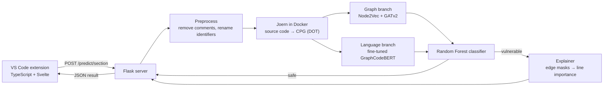

# CoVulPecker

**A VS Code extension that detects security vulnerabilities in C/C++ source code using graph learning and code language models, and highlights the lines most likely responsible.**

CoVulPecker was built by a student research team at the Information Security Laboratory (InSecLab), University of Information Technology (UIT), VNU-HCM, and submitted to the 26th Eureka Student Research Award (2024).

## Highlights

- **Multimodal detection**: combines *structural* features from the Code Property Graph (Joern, Node2Vec, GATv2) with *semantic* features from a fine-tuned GraphCodeBERT model, classified by a Random Forest.
- **Explainable results**: a GNNExplainer-style edge-mask explainer ranks graph nodes by importance and maps them back to source lines, so developers can see *where* the model thinks the vulnerability is.
- **Inside the editor**: a VS Code sidebar lets you scan the whole file or a selected function and shows the verdict, the analysed line range and the execution time.
- **Client–server design**: a Flask REST API serves the models; Joern runs in a Docker container, so the extension works on Windows, Linux and macOS.

## How it works



1. **Preprocessing**: comments are removed and function/variable names are normalised (`func_N`, `var_M`) to reduce noise from coding style.
2. **Graph generation**: Joern parses the code and exports its Code Property Graph (CPG), which merges the AST, CFG and PDG.
3. **Feature extraction**:
   - *Graph branch*: Node2Vec node embeddings refined by a 3-layer GATv2 network.
   - *Language branch*: each node's code label is embedded with GraphCodeBERT fine-tuned on vulnerable C/C++ code.
4. **Classification**: both feature vectors are concatenated and passed to a Random Forest (vulnerable / non-vulnerable).
5. **Explanation**: for vulnerable predictions, an edge-mask explainer (800 optimisation steps) keeps the top-10 most important edges and scores each line by its in/out degree in that subgraph.

## Results

Evaluation on function-level C/C++ samples (binary classification). Numbers come from the team's Eureka 2024 report.

**FUNDED subset**: 22,200 functions covering CWE-78, CWE-122, CWE-134, CWE-190, CWE-191 and CWE-369.

| Features | Classifier | Accuracy | Precision | Recall | F1 |
|---|---|---|---|---|---|
| Graph only (Node2Vec + GAT) | XGBoost | 0.70 | 0.70 | 0.70 | 0.70 |
| GraphCodeBERT only | Random Forest | 0.87 | 0.88 | 0.87 | 0.87 |
| CodeT5 only | Random Forest | 0.87 | 0.88 | 0.87 | 0.87 |
| **Graph + GraphCodeBERT** (used in this tool) | Random Forest | **0.84** | **0.85** | **0.84** | **0.84** |
| Graph + CodeT5 | Random Forest | 0.83 | 0.87 | 0.83 | 0.82 |

- Adding language-model features to the graph branch improves F1 from **0.70 to 0.84** over the graph-only baseline.
- On a harder **Big-Vul** subset (7,415 real-world functions, CWE-20/119/125/190/200), all configurations reach F1 between 0.61 and 0.66.
- The explainer pipeline, tested on a 4,000/1,000 train/test subset of FUNDED, reaches F1 between 0.81 and 0.83.

## Repository structure

```text
CoVulPecker/
├── CoVulPecker-backend/        # Flask API + detection and explanation models
│   ├── server.py               # REST endpoint /predict/section
│   ├── utils.py                # preprocessing, Node2Vec, GATv2, GraphCodeBERT, detector
│   ├── Explainer.py            # edge-mask explainer for the GNN
│   ├── run_docker.py           # runs Joern inside Docker (code → CPG → DOT)
│   ├── Dockerfile              # image with Joern installed
│   └── Model/                  # Random Forest + fine-tuned GraphCodeBERT tokenizer/config
└── CoVulPecker-frontend/       # VS Code extension
    ├── src/                    # extension host code (TypeScript)
    └── webviews/               # sidebar UI (Svelte)
```

## Getting started

### Prerequisites

- Docker
- Python 3.10
- Node.js 18 and npm 10
- VS Code 1.92 or newer

### 1. Build the Joern image

`run_docker.py` starts a container from the image `anhtk20012/joern-teamq:latest`, so build it locally with that tag:

```bash
cd CoVulPecker-backend
docker build -t anhtk20012/joern-teamq:latest .
```

### 2. Add the model weights

The fine-tuned GraphCodeBERT weights (`pytorch_model.bin` or `model.safetensors`) are **not included** because of GitHub's file-size limit. Place them in `CoVulPecker-backend/Model/FTGraphCodeBert.pt/` next to the tokenizer and config files already in the repository.

### 3. Start the backend

Install the Python dependencies used by the backend:

```bash
pip install flask torch torch-geometric torch-scatter transformers node2vec networkx pydot pandas numpy scikit-learn joblib tqdm
```

Then run the server (it listens on `http://127.0.0.1:5000`):

```bash
python server.py
```

### 4. Run the extension

```bash
cd CoVulPecker-frontend
npm install
```

Open the `CoVulPecker-frontend` folder in VS Code and press **F5**. A new *Extension Development Host* window opens. In that window:

1. Open a saved `.c` or `.cpp` file.
2. Click the CoVulPecker icon in the Activity Bar.
3. Choose **Full Code** to scan the whole file, or select a function and choose **Selected Code**.

## API

`POST /predict/section`

```json
{
  "code": "int main() { ... }",
  "lines": [0, 24]
}
```

`lines` is the 0-based start and end line of the submitted code. Response:

```json
[
  { "range": "1-25", "pred": "True", "lines": [7, 9], "average": 0.08 }
]
```

| Field | Meaning |
|---|---|
| `pred` | `"True"` if the code is predicted vulnerable |
| `lines` | Lines ranked important by the explainer (empty when safe) |
| `average` | Share of the analysed lines that were flagged |

## Limitations

- Works on C/C++ code at function level, with two labels (vulnerable / non-vulnerable); it does not report the CWE type.
- Each request runs Node2Vec, the GAT and (for vulnerable code) the explainer from scratch, so a scan can take a while.
- The backend runs locally and has no authentication; do not expose it to a network.

## Tech stack

Python · PyTorch · PyTorch Geometric · Hugging Face Transformers · scikit-learn · Flask · Joern · Docker · TypeScript · Svelte · VS Code Extension API

## References

- Joern: https://joern.io
- FUNDED dataset: Wang et al., *Combining Graph-Based Learning With Automated Data Collection for Code Vulnerability Detection*, IEEE TIFS 2021
- Big-Vul dataset: Fan et al., *A C/C++ Code Vulnerability Dataset with Code Changes and CVE Summaries*, MSR 2020
- GraphCodeBERT: Guo et al., ICLR 2021
- GNNExplainer: Ying et al., NeurIPS 2019
